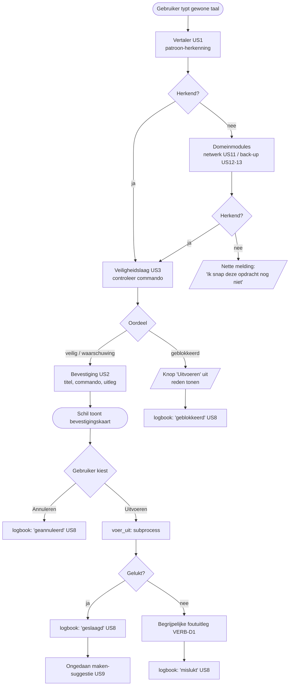

# ONT-D1 — Flowdiagram taal-engine (offline regel-engine)

De kern van Luminosity is een **lokale, offline regel-engine** die gewone taal omzet naar een
Linux-commando en het pas uitvoert ná bevestiging. Geen cloud-AI, geen API-sleutel, geen internet.

Dit flowdiagram toont de volledige pijplijn van invoer tot logboek. Het bewijst het
**veiligheidsprincipe**: `verwerk()` voert nooit iets uit — er gebeurt pas iets na een expliciete
"Uitvoeren" door de gebruiker.

## Toelichting per stap

1. **Vertaler (US1)** — `luminosity_engine/translator.py`: herkent de bedoeling via trefwoord-patronen
   (installeren, verwijderen, updaten, schijfruimte, status) en bouwt het commando.
2. **Domeinmodules (US11–US13)** — `modules/netwerk.py`, `modules/backup.py`: leveren hun eigen
   commando's; de engine routeert hierheen als de vertaler niets herkent (`engine._vertaal`).
3. **Veiligheidslaag (US3)** — `luminosity_engine/safety.py`: blokkeert gevaarlijke commando's
   (`rm -rf /`, `mkfs`, …) en waarschuwt bij risicovolle.
4. **Bevestiging (US2)** — `luminosity_engine/confirm.py`: bouwt het "wat ga ik doen"-bericht.
5. **Uitvoeren** — pas na akkoord; `engine.voer_uit` draait het commando in een subprocess.
6. **Logboek (US8)** — elke afloop (geslaagd/mislukt/geannuleerd/geblokkeerd) wordt vastgelegd.
7. **Ongedaan maken (US9)** — na succes stelt de engine voor hoe je de actie terugdraait.
