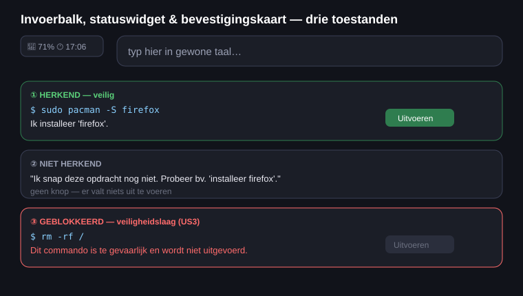

# ONT-D2 — Wireframe invoerbalk + bevestigingskaart + statuswidget

Dit wireframe zoomt in op de **kern-interactie**: de invoerbalk, de statuswidget en de
bevestigingskaart in haar drie belangrijkste toestanden. Het laat zien hoe de UI reageert op het
oordeel van de engine (herkend, niet herkend, geblokkeerd).

## Toestanden

| # | Toestand | Wat ziet de gebruiker | Knop? |
|---|---|---|---|
| ① | **Herkend & veilig** | Commando + uitleg, groene rand | **Uitvoeren** actief |
| ② | **Niet herkend** | Begrijpelijke melding met een voorbeeld | geen knop |
| ③ | **Geblokkeerd (US3)** | Rode rand + reden, commando zichtbaar maar | **Uitvoeren** uit |

Bij een **risicovolle maar toegestane** opdracht (bv. een back-up terugzetten, US13) krijgt de knop
het label **"Toch uitvoeren"** in oranje, zodat de gebruiker bewust een extra drempel neemt.

De **statuswidget** linksboven (US7) toont live schijfruimte en tijd; die gegevens komen uit de engine
(`luminosity_engine/widgets.py`) en niet uit vaste plaatjes.
