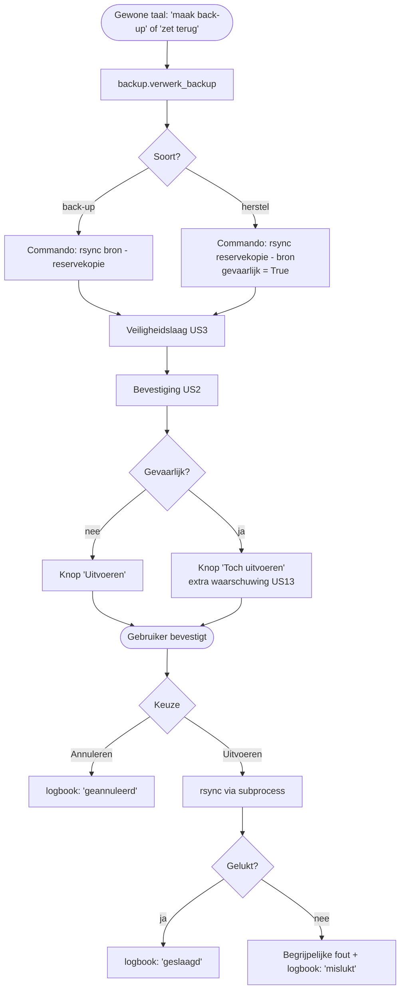

# ONT-G1 — Flowchart back-up-/herstelproces (technisch)

De back-up- en herstelmodule (`modules/backup.py`, US12/US13) loopt — net als alles in Luminosity —
door de volledige engine-pijplijn. Het verschil met gewone opdrachten: **terugzetten is gevaarlijk**
(het overschrijft bestaande bestanden), dus de engine markeert herstel als `gevaarlijk=True` waardoor
de bevestigingslaag een **extra bevestiging** vraagt (US13).

## Toelichting

- **Back-up (US12):** kopieert de documentenmap naar een reservekopie-locatie met `rsync`
  (`modules/backup.py`). Niet-destructief → normale bevestiging.
- **Herstel (US13):** kopieert de reservekopie terug over de originelen. Dit **overschrijft** bestanden
  en is daarom als gevaarlijk gemarkeerd (`engine._vertaal` zet `gevaarlijk=True` voor `soort == "herstel"`),
  zodat de gebruiker bewust "Toch uitvoeren" moet kiezen.
- **Integratie:** beide lopen via dezelfde veiligheids-, bevestigings- en logboeklaag als de rest —
  aangetoond in `tests/test_integration.py`.
