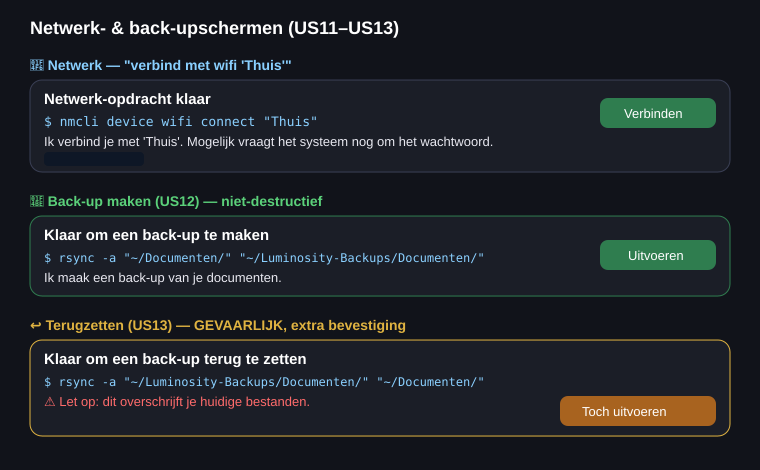

# ONT-G2 — Wireframe netwerk-/back-upschermen

De netwerk- en back-upfuncties (US11–US13) hebben geen apart scherm: ze gebruiken **dezelfde
bevestigingskaart** als de rest van Luminosity. Dit wireframe laat de drie typische kaarten zien en
hoe de UI het verschil tussen veilig en gevaarlijk toont.

## De drie interacties

1. **Netwerk verbinden (US11)** — *"verbind met wifi 'Thuis'"* → `nmcli device wifi connect "Thuis"`.
   Normale bevestiging; de kaart vermeldt dat het systeem nog om een wachtwoord kan vragen.
2. **Back-up maken (US12)** — *"maak een back-up van mijn documenten"* → `rsync` van `~/Documenten`
   naar `~/Luminosity-Backups`. Niet-destructief → groene, normale **Uitvoeren**-knop.
3. **Terugzetten (US13)** — *"zet mijn back-up terug"* → `rsync` de andere kant op. Dit **overschrijft**
   bestaande bestanden en is daarom gemarkeerd als gevaarlijk: oranje kaart, waarschuwing, en de knop
   **"Toch uitvoeren"** als bewuste extra drempel.

**Bron in code:** `modules/netwerk.py` (US11) en `modules/backup.py` (US12/US13). De gevaarlijk-markering
voor herstel zit in `luminosity_engine/engine.py` (`gevaarlijk=True` bij `soort == "herstel"`).
Zie ook de technische flow in [ONT-G1](ONT-G1-flowchart-backup-herstel.md).
