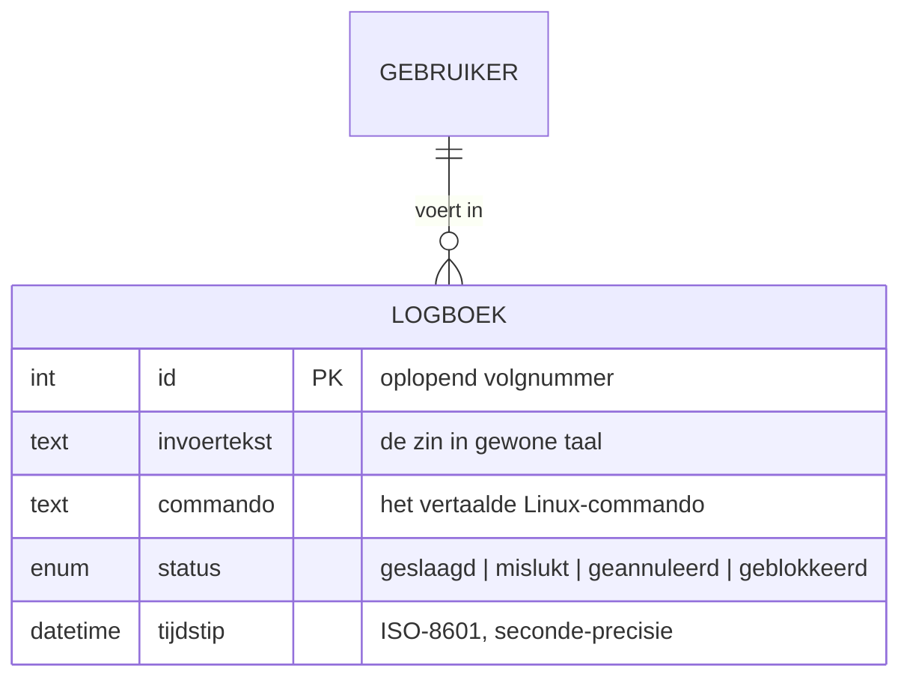

# ONT-K1 — ERD logboek-tabel

Het **logboek (US8)** legt elke opdracht vast die de gebruiker probeerde uit te voeren. In de
huidige implementatie is dit een JSON-bestand (`~/.luminosity/logboek.json`), maar de structuur is
ontworpen als een relationele tabel zodat ze later 1-op-1 naar een database kan (bv. MariaDB).



> De relatie met `GEBRUIKER` is in de huidige single-user-opzet impliciet (één lokale gebruiker per
> systeem). Ze staat in het ERD om de uitbreidbaarheid naar meerdere gebruikers te tonen.

## Veldbeschrijving

| Veld | Type | Omschrijving |
|---|---|---|
| `id` | integer (PK) | Oplopend volgnummer; in JSON `len(regels) + 1`. |
| `invoertekst` | tekst | De originele zin van de gebruiker, bv. *"installeer firefox"*. |
| `commando` | tekst | Het commando dat de engine bouwde, bv. `sudo pacman -S firefox`. |
| `status` | enum | Afloop van de opdracht: `geslaagd`, `mislukt`, `geannuleerd` of `geblokkeerd`. |
| `tijdstip` | datetime | Moment van vastleggen, ISO-8601 met seconde-precisie. |

**Bron in code:** `luminosity_engine/logbook.py` — functie `schrijf()` bouwt exact deze velden;
`lees()` levert de regels voor het logboekpaneel in de schil.

## Voorbeeldregel (JSON)

```json
{
  "id": 7,
  "invoertekst": "installeer firefox",
  "commando": "sudo pacman -S firefox",
  "status": "geslaagd",
  "tijdstip": "2026-06-30T17:06:12"
}
```
