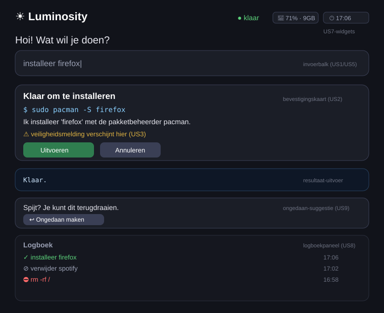

# ONT-T1 — Wireframe Luminosity-schil (Quickshell)

De **Luminosity-schil** is de grafische laag op Hyprland, gebouwd in Quickshell (QML). Dit wireframe
toont het complete scherm en hoe de onderdelen (en hun user stories) samenhangen. De schil voert zelf
niets uit: hij praat met de Python-engine via de JSON-CLI.

## Onderdelen (van boven naar beneden)

1. **Bovenbalk** — merknaam links, **statuswidgets** rechts (US7): live schijfruimte en klok, plus een
   "bezig/klaar"-indicator.
2. **Begroeting + invoerbalk** (US1/US5) — de gebruiker typt een opdracht in gewone taal en drukt Enter.
3. **Bevestigingskaart** (US2) — titel, het vertaalde commando (monospace), begrijpelijke uitleg, een
   veiligheidsmelding (US3), en de knoppen **Uitvoeren** / **Annuleren**. Bij een gevaarlijke opdracht
   wordt de knop "Toch uitvoeren" (oranje, US13).
4. **Resultaatvenster** — de uitvoer van het commando, of een begrijpelijke foutuitleg (VERB-D1).
5. **Ongedaan maken** (US9) — verschijnt na een geslaagde opdracht; biedt het tegen-commando opnieuw aan.
6. **Logboekpaneel** (US8) — de laatste opdrachten met een statusicoon (✓ geslaagd, ⊘ geannuleerd,
   ⛔ geblokkeerd, ✗ mislukt) en tijdstip.

**Bron in code:** `luminosity-shell/qml/shell.qml`. De velden in dit wireframe komen 1-op-1 overeen met
de QML-`property`'s en de JSON die de engine teruggeeft.
